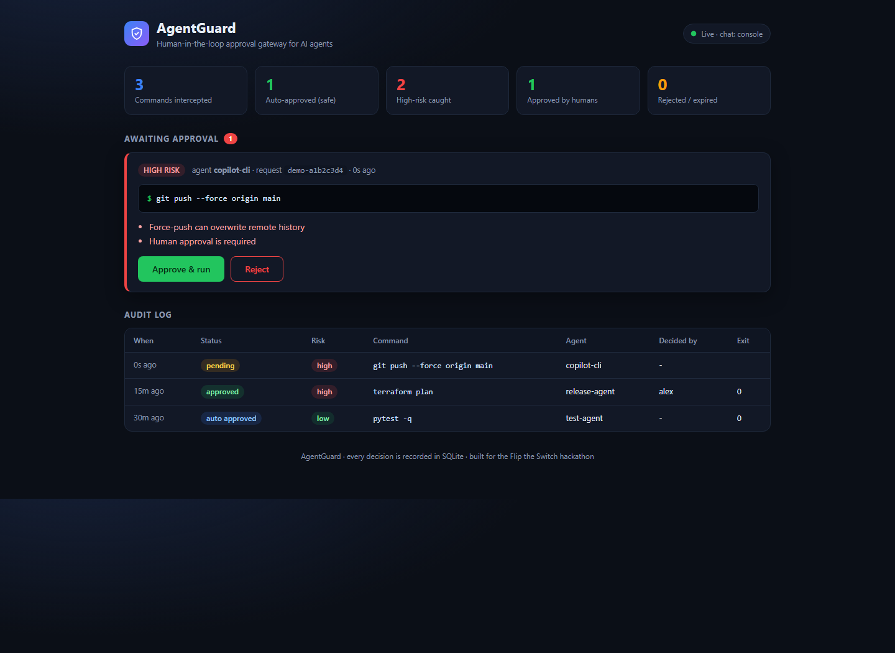

<div align="center">

# 🛡️ AgentGuard

### Let AI agents move fast. Keep a human in charge of anything dangerous.

A human-in-the-loop approval gateway for CLI AI agents, delivered through the team chat you already use.




</div>

---

## The problem

AI coding agents (Claude Code, Cursor CLI, custom agents) run shell commands on your machines. Most of the time that is great. Occasionally it is a disaster:

```
rm -rf ./            terraform destroy -auto-approve
DROP DATABASE prod;  git push --force origin main
```

Today teams choose between two bad options: **approve everything** (unsafe) or **approve every single command** (agents become useless). And when something risky is proposed, nobody else on the team even knows.

## The solution

AgentGuard sits between the agent and the shell and applies one simple rule:

> **Safe commands run instantly. Dangerous commands stop and ask a human in team chat.**

1. The agent proposes a command.
2. AgentGuard **intercepts** it and scores it `LOW / MEDIUM / HIGH`.
3. `LOW` / `MEDIUM`: runs immediately and is audited.
4. `HIGH`: **halted**. An approval card lands in chat showing the exact command, the risk level and *why* it was flagged.
5. A lead engineer clicks **Approve** or **Reject**.
6. On approval the command runs, **stdout/stderr go back to the agent and the chat**, and the decision (who, what, when, exit code) is written to a **SQLite audit log**.

## Demo flow

```
 Agent ──▶ AgentGuard gateway ──▶ risk engine
                │   LOW / MEDIUM ─▶ run now ─▶ audit
                │
                └── HIGH ─▶ ⏸ halt ─▶ approval card in chat
                                          │   [Approve]  [Reject]
                                          ▼
                              human decision (signed, one-time)
                                          │
                       approved ─▶ execute ─▶ output to agent + chat ─▶ audit
                       rejected ─▶ nothing runs ───────────────────────▶ audit
```

## Features

| | |
|---|---|
| **Risk engine** | 20+ regex rules across Linux, macOS and Windows (cmd / PowerShell). Checks the *whole* command string, so `echo ok && rm -rf build` is still caught. |
| **Approval in chat** | Rich cards with command, agent, request ID and the reasons it was flagged. |
| **Multi-chat** | Console, Discord, Mattermost (interactive buttons), Slack. Switch providers with one env var. |
| **Live dashboard** | Pending approvals with one-click Approve / Reject, stat tiles and the audit log, at `http://127.0.0.1:8000`. Works with **no chat setup at all**. |
| **Audit trail** | Every command, risk, reasons, decision-maker, timestamps and exit code in SQLite. Also at `GET /api/audit`. |
| **Secure by design** | HMAC-signed one-time links, atomic decisions (no double execution), request expiry, optional approver allow-list, local-only dashboard. |
| **Tiny footprint** | Four Python modules plus a UI file. Dependencies: `fastapi`, `uvicorn`. Everything else is the standard library. |

## Quick start

```bash
git clone <your-repo-url> agentguard && cd agentguard
pip install -r requirements.txt
cp .env.example .env          # Windows: copy .env.example .env
python main.py                # gateway + dashboard on http://127.0.0.1:8000
```

In a second terminal, play the agent:

```bash
# SAFE: runs instantly
python main.py run "git status"

# DANGEROUS: halts and waits for a human
python main.py run "rm -rf ./demo_dir"                  # Linux / macOS
python main.py run "rmdir /s /q demo_dir"               # Windows
```

Open `http://127.0.0.1:8000` (use `127.0.0.1`, not `localhost`, on Windows), click **Approve & run**, and watch the terminal unblock.

No chat configured? Run the full self-test: `python main.py demo --auto-approve`.

## Connect your team chat

Set `CHAT_PROVIDER` in `.env`:

| Provider | Setup | Approval UX |
|---|---|---|
| `console` | nothing | Approve / Reject links printed in the terminal, plus the dashboard |
| `discord` | Channel ⚙ → Integrations → Webhooks → *New Webhook* → copy URL into `CHAT_WEBHOOK_URL` | Embed card with signed Approve / Reject links |
| `mattermost` | Create an Incoming Webhook; allow the gateway under *Allow untrusted internal connections*; set `PUBLIC_URL` so Mattermost can reach the gateway | Interactive **Approve / Reject buttons** in the post |
| `slack` | Create an Incoming Webhook | Block Kit card with link buttons |

```env
CHAT_PROVIDER=discord
CHAT_WEBHOOK_URL=https://discord.com/api/webhooks/...
PUBLIC_URL=http://127.0.0.1:8000     # use an ngrok URL if reviewers are on other machines
AGENTGUARD_SECRET=change-me-to-something-long
```

### Using it with Switch

[Switch](https://github.com/sandbox-quantum/switch) brings agents into team chat (Slack, Teams, Discord, Telegram, Mattermost). AgentGuard is the **approval layer** for that world: it emits Mattermost interactive messages and Discord / Slack cards, the same chat surfaces Switch bridges, so a human in the room is the one who decides when an agent wants to do something destructive.

> **Honest status:** in this submission the end-to-end demo runs through direct chat webhooks and the built-in dashboard. Bridging AgentGuard inside a Switch-hosted room depends on the Switch bridge being healthy on the host (see *Roadmap*).

## Plug it into your agent

Anywhere your agent would call `subprocess`, call AgentGuard instead:

```python
from main import guarded_run

result = guarded_run("terraform destroy -auto-approve", agent="claude-code")
# blocks until a human approves/rejects in chat
# result -> {"status": "approved", "exit_code": 0, "stdout": "...", ...}
```

Or call the HTTP API from any language:

```bash
curl -X POST http://127.0.0.1:8000/api/intercept \
  -H "Content-Type: application/json" \
  -d '{"command": "git push --force", "agent": "my-agent"}'
```

## Risk engine

| Level | Examples | Behaviour |
|---|---|---|
| 🔴 **HIGH** | `rm -rf`, `rmdir /s`, `del /f /s /q`, `Remove-Item -Recurse`, `DROP DATABASE/TABLE`, `TRUNCATE`, `DELETE FROM x;`, `terraform destroy`, `git push --force`, `sudo`, `mkfs`, `dd of=/dev/…`, `curl … \| sh`, `kubectl delete`, `docker system prune`, `shutdown`, `format C:`, `reg delete`, `eval` | **Halted** until a human approves |
| 🟠 **MEDIUM** | `git reset --hard`, `git push`, `rm`, `mv`, `chmod`, `pip/npm install`, `curl`, `ssh`, `kill` | Runs, audited, FYI posted to chat (configurable) |
| 🟢 **LOW** | everything else (`ls`, `git status`, `echo`, …) | Runs instantly, audited |

Want stricter? `REQUIRE_APPROVAL_LEVELS=high,medium`. Rules live in `interceptor.py` as plain `(regex, reason)` pairs, so adding your own is one line.

## Security model

- **Signed links:** every approve / reject link carries an HMAC token bound to the request ID and action, so IDs can't be guessed or forged.
- **One-time, atomic decisions:** the `pending → approved/rejected` transition is a single guarded SQL `UPDATE`. Double-clicks or replays cannot run a command twice.
- **Expiry:** pending requests expire (`APPROVAL_TTL_SECONDS`, default 300 s), so stale cards can't be approved later.
- **Approver allow-list:** set `APPROVERS=alice,bob` to restrict who may decide.
- **Local-only dashboard:** the dashboard (which holds signed links) refuses any non-local or proxied request.
- **Execution limits:** command timeout (`EXEC_TIMEOUT_SECONDS`), truncated output, optional working directory (`EXEC_CWD`).

## API

| Endpoint | Purpose |
|---|---|
| `POST /api/intercept` | Submit a proposed command, returns `auto_approved` + result, or `pending` + request ID |
| `GET /api/status/{id}` | Poll a request (status, decision-maker, stdout / stderr, exit code) |
| `GET\|POST /api/approve/{id}?token=…` | Approve (browser link or Mattermost button callback) |
| `GET\|POST /api/reject/{id}?token=…` | Reject |
| `GET /api/audit` | Recent audit log as JSON |
| `GET /` | Live dashboard (local only) |
| `GET /health` | Liveness + active chat provider |

## Configuration

| Variable | Default | Meaning |
|---|---|---|
| `CHAT_PROVIDER` | `console` | `console`, `discord`, `mattermost`, `slack` |
| `CHAT_WEBHOOK_URL` | | Incoming webhook URL of your chat |
| `PUBLIC_URL` | `http://localhost:8000` | URL the chat / reviewers use to reach the gateway |
| `AGENTGUARD_SECRET` | random per start | HMAC secret (set a fixed value so old cards survive restarts) |
| `REQUIRE_APPROVAL_LEVELS` | `high` | Levels that need approval |
| `APPROVERS` | empty (anyone) | Comma-separated allowed approvers |
| `APPROVAL_TTL_SECONDS` | `300` | Request expiry |
| `EXEC_TIMEOUT_SECONDS` | `30` | Command timeout |
| `EXEC_CWD` | current dir | Working directory for approved commands |
| `AUDIT_DB` | `agentguard.db` | SQLite file |
| `PORT` | `8000` | Gateway port |

## Project structure

```
agentguard/
├── main.py           # FastAPI gateway, approve/reject handlers, CLI agent wrapper, demo mode
├── interceptor.py    # regex risk engine + command executor
├── chat_webhook.py   # signed links + Discord / Mattermost / Slack / console cards
├── audit.py          # SQLite audit log
├── dashboard.py      # live approval dashboard UI
└── requirements.txt
```

## Limitations (honest)

- Regex rules are a **guardrail, not a sandbox**. Obfuscated commands (encoded payloads, indirect execution) can evade pattern matching. For hard isolation, pair AgentGuard with containers or least-privilege accounts.
- Approved commands run **on the machine hosting the gateway**.
- Discord and Slack webhooks can't hold callback buttons, so those cards use signed links that open a confirmation page; Mattermost gets true interactive buttons.

## Roadmap

- Native Switch room integration: agent traffic in a Switch room routed through the gateway
- Real Slack / Discord interactivity (signed interaction payloads)
- Policy-as-code (per-repo / per-agent rules), LLM-assisted risk explanations
- Two-person approval for the highest-risk actions
- Drop-in shell hook so any agent is guarded without code changes

---

<div align="center">

Built for the **WeMakeDevs · Flip the Switch** AI hackathon.
*Agents get speed on safe work. Humans keep the final say on anything dangerous.*

</div>